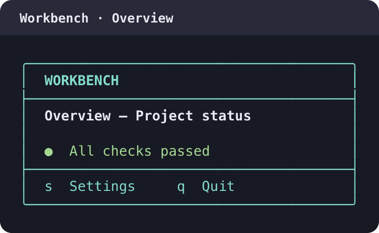

# tui-shot

Turn a live [Herdr](https://herdr.dev/) terminal pane into a screenshot without
moving focus. Save it as a PNG for docs or as selectable, themeable HTML for the
web. No Python, browser, or external PNG renderer required.



## Install

Prebuilt binaries are available for macOS and Linux on arm64 and x64.

```sh
mise use -g packslip:github.com/dkarter/tui-shot@0.1.0
```

Or use [packslip](https://packslip.dev/docs/install/) directly:

```sh
packslip install github.com/dkarter/tui-shot
```

The [GitHub releases](https://github.com/dkarter/tui-shot/releases) include
attested archives, a signed Packslip manifest, and Bash, Fish, and Zsh
completions. Build from source with `cargo install --locked --path .`.

Herdr is needed only for live capture. PNG uses your system fonts. On a minimal
Linux system, install a monospace font such as DejaVu Sans Mono.

## Capture a pane

```sh
herdr pane list
tui-shot --pane "$pane" --title "My app · Overview" -o overview.png
tui-shot --pane "$pane" --theme light --fragment -o overview.html
```

Omit `--pane` to capture the calling Herdr pane. The output extension picks the
format: `.png` (2×), `.svg`, `.html`, `.txt`, or `.ansi`. To render the same
viewport more than once, capture it as `.ansi` and pass it back with `--input`:

```sh
tui-shot --pane "$pane" -o overview.ansi
tui-shot --input overview.ansi -o overview.svg
```

The capture fits the content Herdr returns. The exporter can omit blank
viewport edges and does not include the cursor. Font fallback and complex
Unicode can render differently from the terminal. Review captures before
sharing them: they may include private data. A raw `.ansi` export is not
sanitized.

## Publish text, not pixels

HTML output preserves colors and terminal text, including Unicode box drawing.
Use `--fragment` to embed it on a site that allows inline styles. Switch
`data-theme` on the `<figure>` between `dark` and `light`, or override CSS
variables for your site:

```css
.tui-shot {
  --tui-bg: #10141c;
  --tui-fg: #eaf2ff;
  --tui-border: #3c4356;
  --tui-c6: #5eead4;       /* ANSI cyan; c0–c15 are palette entries */
  --tui-rgb-fa9646: #ffcc66; /* Override one exact RGB value */
}
```

## Script a tutorial

Run the app in a dedicated pane at a consistent size. After sending keys,
wait for text unique to the next screen before capturing it:

```sh
set -e
pane="${1:?pass the demo pane ID}"
herdr pane send-keys "$pane" s
herdr pane wait-output "$pane" --source visible --match 'Settings — General' \
  --timeout 5000 >/dev/null
tui-shot --pane "$pane" --title "02 · Settings" -o 02-settings.png
```

## Completions

Activated mise can load the completions declared in the Packslip manifest.
For a manual install, generate your shell's script with
`tui-shot completions bash`, `tui-shot completions fish`, or
`tui-shot completions zsh`. To get the Usage spec, run `tui-shot __usage_spec__`.

## Releases

Conventional Commits drive the Release Please PR. Merging it creates a draft
release, then CI builds and attests each archive and attaches the signed
Packslip bundle before publishing. Keep immutable releases enabled, and allow
GitHub Actions to create pull requests so Release Please can open its PR.
GitHub may hold CI on automation-created PRs for approval.

To resume a failed draft, dispatch the `Release` workflow on the tag itself:

```sh
gh workflow run release.yml --ref v0.1.0 -f resume_tag=v0.1.0
```
